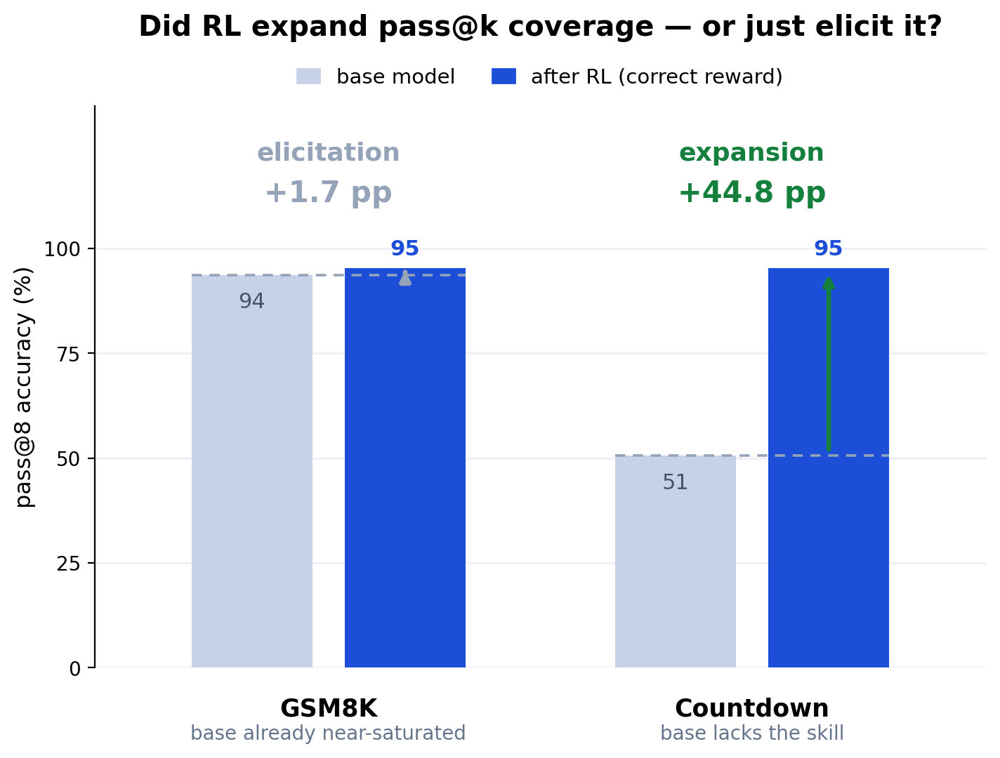

# grpo-decomp

 

When GRPO raises a benchmark score, how much of the gain is new reasoning, and how much is
the base model getting more reliable at answers it could already find? This repo measures
that split with controls, and finds both outcomes, depending on the base model and the task.

## Thesis

On a benchmark the base model has already saturated, the GRPO gain is **elicitation**:
pass@1 rises, but pass@k coverage stays where it was. On a task the base model cannot do,
the same protocol reports **expansion**: coverage rises too. On a stronger base model the
same task still expands, but by less, because the base already covers more of it. A pass@1
gain alone cannot tell these cases apart. A random-reward placebo, seed aggregation,
and per-problem accounting can.



**Reading the numbers:** _pass@1_ is reliability (the model solves the problem on the first
try). _pass@8_ is coverage (the model solves it in _any_ of 8 tries). A pass@1 gain without
a pass@8 gain means the model gives answers it already had more often. It is not new
capability.

## Results

### GSM8K: reliability, not new coverage

_Qwen2.5-Math-1.5B · 6 seeds · GSM8K test, n=1319_

GRPO beats a random-reward placebo by **+3.9 pp, 95% CI [2.3, 5.6]**: real, but modest.
Coverage barely moves: Δ +0.7 pp, bounded by a conservative [-0.4, +1.9]. The base model
already reaches these answers: base pass@8 (94.0%) is far above correct pass@1 (76.2%).
Per problem, **0.0% of the GSM8K gain is new capability**. Every problem that the trained
model newly solves reliably was already inside the base model's pass@8 reach. The
controls hold: base pass@8 holds at 90.8% on renumbered GSM-Symbolic, so that reach is not
memorized answers. A verifiable-chain check could not run on this model: it found 0.0%
verifiable-chain coverage in the CoT-gated check.

### Countdown: expansion (the positive control)

_general Qwen2.5-1.5B · 3 seeds · generated test set, n=192_

Countdown is an arithmetic search task that the base model mostly cannot do. It is
generated, so it cannot be contaminated. Gain over placebo: **+46.5 pp, 95% CI [21.4, 71.6]**.
This time coverage rises with it: **Δ +41.0 pp, 95% CI [35.1, 46.9]** (base 53.6% → correct
94.6%). Per problem, 10.9% on Countdown is genuinely new: problems the trained model
solves reliably that the base model never solves in 8 tries. The protocol does not always
report elicitation. When RL adds coverage, the protocol shows it.

**Same base model (pre-registered follow-up).** The comparison above changes two things at
once: the task and the base model. Training the GSM8K base, Qwen2.5-Math-1.5B, on Countdown
separates them. Its base pass@8 is already 84.8%, and RL adds **Δ +11.8 pp, paired 95% CI
[8.3, 15.5]**: still expansion under the pre-registered rule, and far above GSM8K's +0.7 pp.
But only 0.5% of problems are genuinely new. So the task effect is real, and the base model
sets how much room RL has.

Full writeups, figures, and the decontamination, mechanism, and CoT-gated checks:
[GSM8K](results/FINDINGS.md) · [Countdown](results/countdown/FINDINGS.md) ·
[pre-registered follow-ups](results/preregistered-results-2026-10.md).

## Relation To Prior Work

- **Yue et al. 2025**, _Does Reinforcement Learning Really Incentivize Reasoning Capacity
  in LLMs Beyond the Base Model?_ At 7B–32B, RLVR models win at small k, and base models win
  at large k (up to k=1024). This repo finds the same elicitation pattern at 1.5B on GSM8K.
  It adds a random-reward placebo, seed-level intervals, and a positive control that shows
  the protocol can also report expansion. It measures coverage only at k=8 (see
  Limitations).
- **Shao et al. 2025**, _Spurious Rewards: Rethinking Training Signals in RLVR_. Random
  rewards raise Qwen2.5-Math-7B on MATH-500 by 21.4 pp (29.1 pp for the true reward).
  Qwen2.5-Math-1.5B gains more slowly, only after about 100 steps (the runs here last 500). The authors trace the effect
  to GRPO's clipping term: without clipping, the random-reward gain disappears. Here, the
  random-reward placebo on Qwen2.5-Math-1.5B stays flat (75.8% vs base 76.4%). That
  training is fully on-policy: TRL 1.0.0 with `num_iterations=1` and one optimizer step per
  rollout batch, so the policy ratio stays at 1 and the clip never binds. Their mechanism
  predicts no gain in this regime. A pre-registered off-policy placebo
  (`steps_per_generation: 4`) also stays flat: **+0.4 pp, 95% CI [-0.8, +1.6]** over base.
  But in the retained (early) training logs the clip bound on under 0.02% of tokens at
  learning rate 1e-6, so this test barely exercises the mechanism. It shows the flat placebo is robust to off-policy updates. It
  does not settle the clipping question at 1.5B.
- **Liu et al. 2025**, _ProRL: Prolonged Reinforcement Learning Expands Reasoning
  Boundaries in Large Language Models_. Long RL training on diverse tasks expands pass@k
  beyond the base model. The runs here are short (500 steps, one prompt per step), so the
  GSM8K result says nothing about long-horizon RL.
- **Wen et al. 2025**, _Reinforcement Learning with Verifiable Rewards Implicitly
  Incentivizes Correct Reasoning in Base LLMs_. Pass@k can count lucky final answers, so they
  require a correct chain of thought (CoT-Pass@k). The non-neural chain check here does not
  apply to these models (0% chain coverage), so this repo cannot answer that critique.

**Contribution:** a controls-first protocol (placebo, seed aggregation, paired per-problem
accounting, and a positive control), packaged as a task-agnostic harness. With it: a
small-scale replication of the elicitation result, a pre-registered same-base control that
confirms the task effect on one base model, and a mechanism-level reason why the placebo is
flat in on-policy GRPO.

## Limitations

- **Coverage only at k=8.** "New capability" means outside the base model's pass@8 (base
  n=16, correct n=8). Yue et al. see the base and RL curves cross at k in the tens to
  hundreds. Countdown's 10.9% new-capability share may shrink at larger k.
- **The headline Countdown contrast changes the base model.** The published +41.0 pp uses
  general Qwen2.5-1.5B. The same-base follow-up (+11.8 pp on Qwen2.5-Math-1.5B) has 3 seeds
  and no random-reward placebo; it compares against the base model only.
- **Small and narrow.** One model family (Qwen), 1.5B parameters, 500 steps, one prompt per
  optimizer step. The placebo is a within-Qwen lower bound, not a cross-family result.
- **Weak clipping test.** The off-policy placebo barely made the clip bind (under 0.02% of
  tokens in the retained early logs). It also mixes 4 prompts per optimizer step, a second
  change TRL makes alongside off-policy updates. The clipping-driven random-reward effect is
  still untested at 1.5B.
- **Problem noise in the intervals.** The GSM8K and Countdown placebo and control intervals
  are seed-level t intervals, which leave out problem-sampling noise. The harness now has a
  paired seed × problem bootstrap. The per-problem completions for these runs are no longer
  retained, so these intervals cannot be recomputed. Countdown has 3 seeds (df=2).
- **No reasoning-validity check.** Correct answers are not proof of correct reasoning, and
  the verifiable-chain check does not apply to these models.
- **Aggregates only for GSM8K and Countdown.** For these two studies the repo ships result
  JSON and figures. An outsider can rebuild every figure and doc number, but cannot recompute
  them from completions. The Esme study ships its raw completions: `make reproduce-esme`
  recomputes its result from them.

## What I Would Do Next

In order of information per GPU dollar:

1. **pass@k curves to k=256** on a problem subset, for both tasks. This tests the k=8
   limitation directly.
2. **An off-policy placebo where the clip actually binds**: a higher learning rate or more
   optimizer steps per rollout batch, with the clip fraction logged. The first off-policy
   placebo barely engaged the clip.
3. **A random-reward placebo for the same-base Countdown pair**, to put that +11.8 pp on the
   same footing as the other headline gains.
4. **A non-Qwen family** (Llama), to make the placebo a cross-family result.

## Appendix: Esme-214M (Form, Not Reasoning)

_trained from scratch · 6 seeds · 30 held-out problems_

A side study on a 214M model from the
[Esme](https://github.com/adamthuvesen/esme-pretrain/blob/main/docs/retrospective.md)
pretraining project. Real reward teaches well-formed Countdown expressions: the
valid-expression rate is 85.4% for real reward vs 0.8% for the placebo,
**+84.7 pp, 95% CI [+60.1, +97.5]** (seed × problem bootstrap). Exact solving barely
clears zero: **+8.9 pp, 95% CI [+0.6, +19.4]**, carried by the same three problems in every
seed. [Writeup](results/esme-countdown/sampled_decomposition.md).

## How It Works

Two packages share one boundary:

- `grpo_decomp`: the task-agnostic harness. It trains GRPO arms, samples and freezes
  completions as artifacts, grades them, and reports controlled comparisons.
- `llm_grpo_gains`: the reference study. It plugs GSM8K and the Countdown positive control
  into the harness.

It is not a general RL platform. It is a small measurement system built on controls,
confidence intervals, paired tests, and reproducible artifacts.

Training and analysis meet at a committed artifact boundary:

1. Train one arm with a recorded base model, reward, seed, dataset, and config.
2. Generate completions from the base model and trained checkpoints.
3. Freeze them as `CompletionSet` directories.
4. Grade and aggregate across seeds offline on CPU.

Only training and generation need a model backend. Once a `CompletionSet` exists,
analysis is deterministic: no GPU, network, or Hugging Face access.

The harness stays task-agnostic through registries in `grpo_decomp/registries.py`. The
study registers its datasets, rewards, verifiers, and prompt strategies through the
`grpo_decomp.plugins` entry point. Published runs used Modal for training/generation
and W&B for curves. The public repo ships the derived result JSON and figures, not the
run volumes or checkpoints. Module map and data flow: [docs/architecture.md](docs/architecture.md).

## Quickstart

```bash
make install   # CPU env: data, rewards, eval, stats, reports, tests
make check     # Ruff + mypy + unit tests + docs consistency
make results   # rebuild committed figures from JSON, then docs <-> JSON check
make demo      # score two tiny committed CompletionSets; no model load
make reproduce-esme  # recompute the Esme result from its raw completions; diff vs committed JSON
```

Generation and training need a model backend; everything else runs on CPU:

```bash
uv sync --extra generate
grpo-decomp generate --model Qwen/Qwen2.5-Math-1.5B --set dev --backend transformers --out runs/base__dev
grpo-decomp battery  --completions runs/base__dev --k 1
```

Run `grpo-decomp --help` for the full command set. To train an arm on Modal and
reproduce the published runs, see [docs/runbook.md](docs/runbook.md).

## Plug In Your Own Model And Task

`--model` / `ArmConfig.base_model` takes any Hugging Face id or local checkpoint path.
To add a task, write a `register()` that registers your eval set, train dataset, and
reward (plus a verifier and validation reconstructor for non-boxed-math tasks), then
declare it under the `grpo_decomp.plugins` entry point.
[src/llm_grpo_gains/registration.py](src/llm_grpo_gains/registration.py) is the worked
example.

## Study Rules

- No headline gain without controls, confidence intervals, and paired tests.
- Aggregate over seeds before making a claim; below three seeds, label it preliminary.
- Treat reward curves as training diagnostics, not evidence.
- Record dataset and model revisions, config, commit, dependency versions, seeds, and
  sampling settings on every artifact.
- Make skipped records, malformed artifacts, and unparseable completions visible.

## Stack

Python 3.11+ · `uv` · Pydantic · TRL GRPO · transformers · vLLM · Modal ·
[`eval-audit`](https://github.com/adamthuvesen/eval-audit)

## References

- Shao et al., [_DeepSeekMath: Pushing the Limits of Mathematical Reasoning in Open Language Models_](https://arxiv.org/abs/2402.03300), 2024.
- Guo et al., [_DeepSeek-R1 incentivizes reasoning in LLMs through reinforcement learning_](https://www.nature.com/articles/s41586-025-09422-z), 2025.
- Yang et al., [_Qwen2.5-Math Technical Report: Toward Mathematical Expert Model via Self-Improvement_](https://arxiv.org/abs/2409.12122), 2024.
- Cobbe et al., [_Training Verifiers to Solve Math Word Problems_](https://arxiv.org/abs/2110.14168), 2021.
- Mirzadeh et al., [_GSM-Symbolic: Understanding the Limitations of Mathematical Reasoning in Large Language Models_](https://arxiv.org/abs/2410.05229), 2024.
- Vendrow et al., [_Do Large Language Model Benchmarks Test Reliability?_](https://arxiv.org/abs/2502.03461), 2025.
- Wen et al., [_Reinforcement Learning with Verifiable Rewards Implicitly Incentivizes Correct Reasoning in Base LLMs_](https://arxiv.org/abs/2506.14245), 2025.
- Chen et al., [_Evaluating Large Language Models Trained on Code_](https://arxiv.org/abs/2107.03374), 2021.
- Yue et al., [_Does Reinforcement Learning Really Incentivize Reasoning Capacity in LLMs Beyond the Base Model?_](https://arxiv.org/abs/2504.13837), 2025.
- Shao et al., [_Spurious Rewards: Rethinking Training Signals in RLVR_](https://arxiv.org/abs/2506.10947), 2025.
- Liu et al., [_ProRL: Prolonged Reinforcement Learning Expands Reasoning Boundaries in Large Language Models_](https://arxiv.org/abs/2505.24864), 2025.
- Pan, [_TinyZero_](https://github.com/Jiayi-Pan/TinyZero), 2025.

## License

MIT
