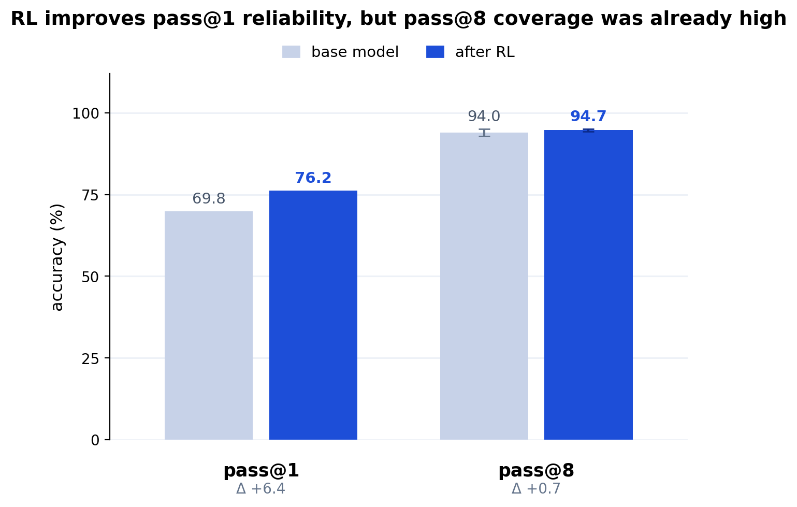
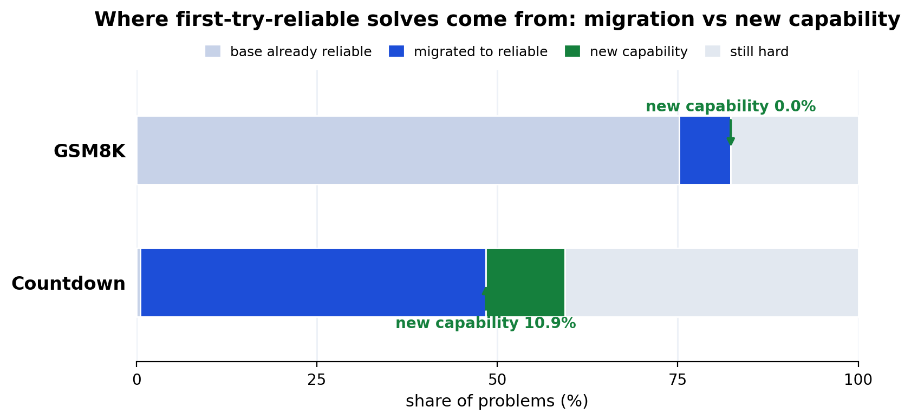

# GSM8K findings

_Qwen2.5-Math-1.5B · GRPO with a correctness reward · 6 training seeds per arm ·
GSM8K test, n=1319_

**Result.** GRPO beats a random-reward placebo by **+3.9 pp, 95% CI [2.3, 5.6]**. The gain is
elicitation: the trained model is more reliable on problems the base model already solves,
and pass@8 coverage barely moves. Contamination, perturbation, and label-noise controls do
not explain the gain.

| Measurement | Setting | Artifact |
| --- | --- | --- |
| Placebo comparison | greedy pass@1, lenient grading, 1024 tokens | `seed-placebo-comparison.json` |
| Coverage | pass@8 at temperature 0.7, base n=16, correct n=8 | `pass8-multiseed.json` |
| Per-problem mechanism | reliability threshold τ = 0.5 | `mechanism.json` |
| Controls | 3 control sets, Holm-corrected | `decomposition-multiseed.json` |

![Placebo comparison over 6 seeds: +3.9 pp [2.3, 5.6]](fig-placebo-comparison.png)

## Placebo comparison

correct − random over 6 seeds: **+3.9 pp, 95% CI [2.3, 5.6]** (seed-level t, df=5). All six
seeds are positive.

| Seed | random | correct | Δ (pp) |
| --- | --- | --- | --- |
| 0 | 75.3% | 81.4% | +6.1 |
| 1 | 74.5% | 78.6% | +4.2 |
| 2 | 76.6% | 78.6% | +2.0 |
| 3 | 77.0% | 79.5% | +2.4 |
| 4 | 76.0% | 79.9% | +3.9 |
| 5 | 75.6% | 80.7% | +5.1 |

The placebo does not help: random reward stays at 74.5–77.0% on every seed, against a base
of 76.4%.

## Coverage

| Arm | pass@1 (sampled) | pass@8 |
| --- | --- | --- |
| base | 69.8% | **94.0% [92.9, 95.0]** |
| correct, 6-seed mean | 76.2% | 94.7% [94.3, 95.1] |

- **The base model already reaches the answers.** Base pass@8 (94.0%) is far above
  correct pass@1 (76.2%). RL raises first-try reliability inside that reach.
- **Coverage moves by under 2 pp.** Δ +0.7 pp. The seed-level interval is [+0.4, +1.1], with
  the base held fixed. Adding the base model's own sampling noise, unpaired, gives
  [-0.4, +1.9]. Both bound the move far below Countdown's +41.0 pp
  ([Countdown findings](countdown/FINDINGS.md)).
- **The reach is not memorization.** On renumbered problems (GSM-Symbolic), which the base
  model cannot have memorized, base pass@8 is 90.8%. On cleaned labels (GSM8K-Platinum), a
  label-noise check, it is 95.6%
  ([contamination and label-noise findings](decontam/FINDINGS.md)).

## Per-problem mechanism

The base model already solves 75.2% of problems reliably on the first try. The trained model
makes 7.1% reliable and 0.0% genuinely new: every newly reliable problem was already inside
the base model's pass@8 reach, so 100% of the added reliability is migration. Completion
length stays flat (224 → 226 words).

## Controls

correct − base per training seed, seed-level t CI (df=5), Holm-Bonferroni across the three
rows:

| Control | Checks | Δ (pp) | 95% CI | p (Holm) |
| --- | --- | --- | --- | --- |
| gsm-symbolic | memorization (renumbered) | +4.1 | [0.8, 7.5] | 0.0253 |
| gsm-plus | robustness (perturbation) | +3.5 | [2.7, 4.4] | 0.00028 |
| gsm8k-platinum | label noise (cleaned) | +3.2 | [1.9, 4.5] | 0.0027 |

All three gains stay significant after correction. Contamination affects the base model,
not the RL gain: Base drops 76% → 63% from GSM8K test to renumbered GSM-Symbolic, while its
pass@8 reach holds. On seed 0, format contributes +0.8 pp (lenient vs strict grading;
`single-seed-controls.json`).

## Why the tool requires seeds

Seed 0 overstates every gain that the 6-seed mean confirms:

| Measurement | Seed 0 → 6-seed mean (pp) |
| --- | --- |
| Placebo comparison | +6.1 → +3.9 |
| gsm-symbolic control | +10.5 → +4.1 |
| gsm-plus control | +4.9 → +3.5 |
| gsm8k-platinum control | +4.8 → +3.2 |

A single run gives a confident number (seed 0's placebo test has McNemar p = 3e-9) that
seed aggregation shrinks by about 30–60%. This is why the harness labels any result
from fewer than three seeds preliminary.

## Verifiable-chain check

CoT-Pass@k ([Wen et al. 2025](https://arxiv.org/abs/2506.14245)) counts a solve only when its
reasoning chain verifies. The non-neural version here needs GSM8K's `<<a op b = c>>`
calculator steps. Qwen2.5-Math never writes them: chain coverage is 0.0%, so CoT-gated
pass@8 is 0.0% for base and correct alike. The check does not apply to this model, and it
gives no verdict on reasoning validity.
