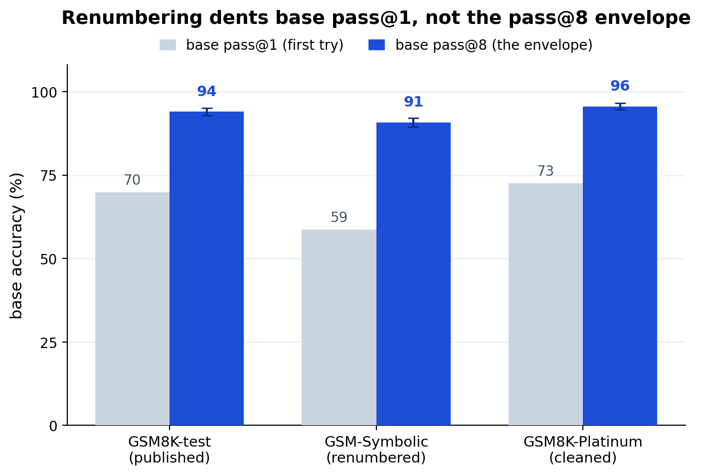

# Decontamination findings

_The GSM8K pass@8 panel (same checkpoints and decoding: base n=16, 6 correct seeds at n=8,
temperature 0.7), re-run on two distributions the base model cannot have memorized._

**Result.** The elicitation verdict is not a contamination artifact. Off the memorizable
distribution, base pass@8 stays high and far above correct pass@1, and RL still moves
coverage by under 2 pp. Contamination inflates the base model's first try, not its reach.

| Distribution | Change | Size |
| --- | --- | --- |
| `gsm-symbolic` | same templates, renumbered values, so memorized answers are wrong | 1319 (deterministic subsample of 5000, matched to the test set) |
| `gsm8k-platinum` | GSM8K with cleaned labels | 1209 |

| Distribution | base pass@1 | base pass@8 | correct pass@1 | Δ pass@8 (95% CI) |
| --- | --- | --- | --- | --- |
| gsm8k-test | 69.8% | **94.0% [92.9, 95.0]** | 76.2% | +0.7 [-0.4, +1.9] |
| gsm-symbolic | 58.6% | **90.8% [89.4, 92.1]** | 63.8% | +1.8 [+0.2, +3.4] |
| gsm8k-platinum | 72.6% | **95.6% [94.6, 96.5]** | 78.8% | +0.8 [-0.3, +1.8] |

- **Renumbering hits the first try, not the reach.** Base pass@1 falls 11 pp (69.8% →
  58.6%), but base pass@8 falls only 3 pp (94.0% → 90.8%). The base model derives these
  answers; it does not recall them.
- **The reach still exceeds the trained model's first try.** Base pass@8 is 27.0 pp above
  correct pass@1 on renumbered problems (17.7 pp on the test set).
- **Coverage moves little everywhere.** Δ pass@8 is +0.8 to +1.8 pp. On renumbered problems
  the interval clears zero, a small real gain, but it is more than 20× below Countdown's
  +41.0 pp expansion.

Artifacts: `pass8-symbolic.json`, `pass8-platinum.json`. As on the test set, chain coverage
is 0.0%, so the verifiable-chain check does not apply.
