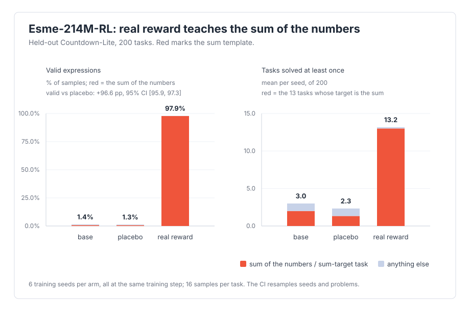

# Esme-214M findings: the reward teaches the sum of the numbers

6 real-reward seeds and 6 random-reward placebo seeds. 200 held-out Countdown-Lite tasks. 16 samples per task at temperature 1, with 12 new tokens.

The real-reward model writes the sum template in 97.7% of samples. The descriptive pattern supports a sum-template interpretation. The model solves almost only tasks whose target equals the sum of the numbers.

The three outcomes form a retrospective exploratory family. No primary endpoint was specified. Raw sign-flip p-values remain visible. Holm correction covers all three outcomes. The 95% confidence intervals are marginal, not simultaneous. These exploratory tests do not establish a confirmatory result.

## Results

| Measure | Real reward | Placebo | Real - placebo, marginal 95% CI | Raw p | Holm p |
| --- | ---: | ---: | --- | ---: | ---: |
| Valid expressions | 97.9% | 1.29% | +96.6 pp [+95.9, +97.3] | 0.03125 | 0.09375 |
| Exact solves, per sample | 6.3% | 0.07% | +6.2 pp [+3.2, +9.6] | 0.03125 | 0.09375 |
| Tasks solved at least once | 6.6% | 1.17% | +5.4 pp [+2.1, +9.0] | 0.03125 | 0.09375 |

| Arm | Valid | Sum of the numbers | Sum-target tasks solved | Other tasks solved |
| --- | ---: | ---: | ---: | ---: |
| base | 1.4% | 0.8% | 2.0 | 1.0 |
| placebo | 1.3% | 0.7% | 1.3 | 1.0 |
| real reward | 97.9% | 97.7% | 13.0 | 0.2 |

| Seed | real valid | real sum of the numbers | real solved | placebo valid | placebo solved |
| --- | ---: | ---: | ---: | ---: | ---: |
| 214 | 98.1% | 97.9% | 13 + 0 | 1.2% | 1 + 1 |
| 215 | 98.0% | 97.9% | 13 + 0 | 0.8% | 1 + 1 |
| 216 | 98.2% | 98.1% | 13 + 0 | 1.7% | 1 + 1 |
| 217 | 97.8% | 97.5% | 13 + 0 | 1.3% | 2 + 1 |
| 218 | 97.8% | 97.6% | 13 + 0 | 1.4% | 2 + 1 |
| 219 | 97.5% | 97.2% | 13 + 1 | 1.4% | 1 + 1 |

## Metrics and method

A valid expression uses every supplied number exactly once with binary `+ - *`. A sum template is a valid expression that uses only `+`. An exact solve reaches the target. A task is solved when any sampled expression reaches it.

13 of the 200 held-out tasks have a target equal to the sum of their numbers. The sum template solves that subset. Other solves test whether the behavior extends beyond the template.

The real-reward and placebo arms use the same recipe and budget. The committed runs use one fixed checkpoint at training step 240. No checkpoint is selected by training reward. Each comparison pairs seeds and problems. The bootstrap resamples seeds and problems together. The exact sign-flip test uses the seed-level effects. The reported intervals do not adjust for multiplicity.

The training reward gives partial credit for well-formed and valid expressions, plus closeness to the target. The sum template earns that credit on many tasks. The [esme-posttrain research report](https://github.com/adamthuvesen/esme-posttrain/blob/main/docs/rlvr-research-report.md) reports reward ablations. This analysis does not recompute those ablations.

## Limitations

The findings cover one task and one model size. The held-out tasks use the training generator's distribution. In the committed set, 199 of 200 tasks have three numbers. Six seeds limit the smallest two-sided sign-flip p-value to 0.03125. Output form identifies the template. It does not reveal internal representations. The retrospective family limits confirmatory claims.

- Training identity is unavailable for some inputs. Seed labels are supplied, not verified.
- Rendered prompt identity is unavailable for some inputs. Only strategy names match.
- Legacy inputs do not record a verifier; the installed verifier was used.

Reproduce the historical JSON with `make reproduce-esme`. The explicit `--legacy` mode preserves `sampled_multiseed_summary.json`. Default analysis writes `sampled_multiseed_summary.corrected.json` and this report.
