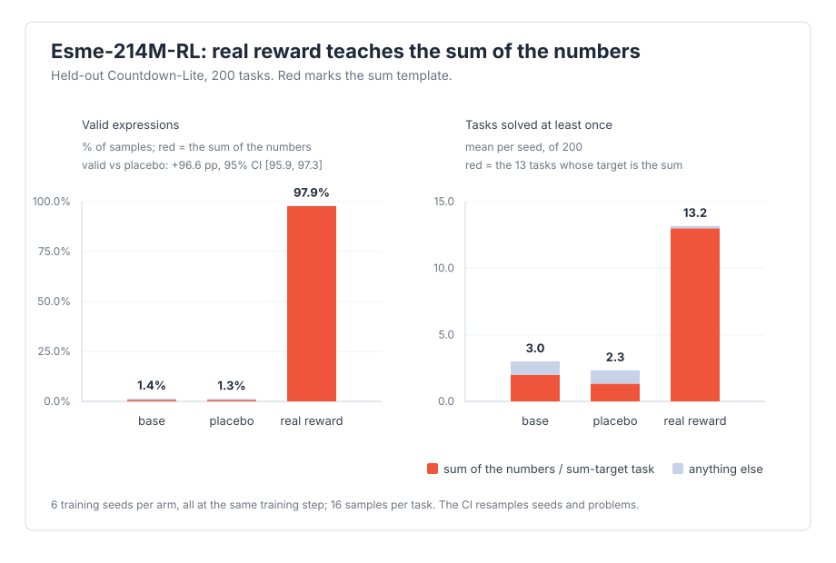

# Esme-214M findings: the reward teaches the sum of the numbers

_Esme-214M-RL (GRPO from Esme-214M-Chat) · 6 real-reward seeds vs 6 random-reward placebo
seeds, all evaluated at training step 240 · 200 held-out Countdown-Lite tasks · 16 samples
per task at temperature 1.0, 12 new tokens_

**Result.** Real reward moves every measure past the placebo. What it teaches is one
template: add all the numbers. 97.7% of real-reward samples are the sum of the supplied
numbers, whatever the target. Every real-reward seed solves the 13 held-out tasks whose
target is the sum. Across all six seeds, it solves one other task, in one seed. The gain is
a reward hack, not arithmetic.

| Measure | Real reward | Placebo | Real − placebo, 95% CI | Sign-flip p |
| --- | ---: | ---: | --- | ---: |
| Valid expressions | 97.9% | 1.3% | +96.6 pp, 95% CI [+95.9, +97.3] | 0.031 |
| Exact solves, per sample | 6.3% | 0.07% | +6.2 pp, 95% CI [+3.2, +9.6] | 0.031 |
| Tasks solved at least once | 6.6% | 1.2% | +5.4 pp, 95% CI [+2.1, +9.0] | 0.031 |

Valid-expression rates are 97.9% vs 1.3% for real reward vs placebo. With six seeds,
p = 0.031 is the smallest p that the sign-flip test can give.

## Metrics

- **Valid expression:** the sample is a legal Countdown-Lite expression. It uses each
  supplied number exactly once, with binary `+ - *` only, whether or not it hits the target.
- **Sum of the numbers:** a valid expression that uses only `+`. Its value is the sum of the
  numbers, whatever the target.
- **Exact solve:** the expression hits the target.
- **Task solved:** at least one of the 16 samples is an exact solve.

## Where the solves come from

13 of the 200 held-out tasks have a target equal to the sum of their numbers. The sum
template solves those tasks and no others.

| Arm | Valid | Sum of the numbers | Sum-target tasks solved (of 13) | Other tasks solved (of 187) |
| --- | ---: | ---: | ---: | ---: |
| base (Esme-214M-Chat) | 1.4% | 0.8% | 2 | 1 |
| placebo, mean of 6 seeds | 1.3% | 0.7% | 1.3 | 1.0 |
| real reward, mean of 6 seeds | 97.9% | 97.7% | 13.0 | 0.2 |

Per seed (solved = sum-target tasks + other tasks):

| Seed | real valid | real sum of the numbers | real solved | placebo valid | placebo solved |
| --- | ---: | ---: | ---: | ---: | ---: |
| 214 | 98.1% | 97.9% | 13 + 0 | 1.2% | 1 + 1 |
| 215 | 98.0% | 97.9% | 13 + 0 | 0.8% | 1 + 1 |
| 216 | 98.2% | 98.1% | 13 + 0 | 1.7% | 1 + 1 |
| 217 | 97.8% | 97.5% | 13 + 0 | 1.3% | 2 + 1 |
| 218 | 97.8% | 97.6% | 13 + 0 | 1.4% | 2 + 1 |
| 219 | 97.5% | 97.2% | 13 + 1 | 1.4% | 1 + 1 |

## Reading

- **The reward signal causes the change.** The placebo runs the same recipe and budget with
  a reward that ignores the answer. It stays at the base model's level on every measure.
- **The change is a reward hack.** The training reward gives partial credit: 0.05 for a
  well-formed answer, 0.3 for a valid expression plus up to 0.3 for closeness to the target,
  and 1.0 for an exact solve. The sum is always a valid expression and often close to the
  target, so it earns most of that credit on every task.
- **The validity gain is not a step toward solving.** A model that learned arithmetic would
  solve tasks whose target is not the sum. The real-reward model solves 0.2 of the 187 such
  tasks per seed, below the base model's 1.

The [esme-posttrain research report](https://github.com/adamthuvesen/esme-posttrain/blob/main/docs/rlvr-research-report.md)
tests the mechanism with reward ablations. Closeness credit alone causes the collapse to the
sum template. Only a binary exact-only reward avoids it. Those ablations are reported there
and are not recomputed here.

## Method

- **One fixed checkpoint.** Every arm is evaluated at training step 240. No checkpoint is
  picked by its training reward.
- **Paired comparison.** Each seed's real-reward arm is paired with its placebo arm, problem
  by problem. Each interval resamples seeds and problems together (6 seeds × 200 problems).
  Each p-value is an exact sign-flip test over the six seed-level effects.
- **Independent grading.** `scripts/esme_sampled_decomp.py` grades the same CompletionSets as
  the esme-posttrain study report, with this repo's own verifier. The two graders agree on
  every sample. Interval bounds can differ by 0.1 pp, because the two bootstraps draw
  different resamples.

## Limitations

- **One task, one model size.** The findings describe Countdown-Lite at 214M parameters.
- **In-distribution held-out set.** The held-out tasks come from the training generator's
  distribution, and 199 of the 200 have three numbers.
- **Six seeds.** The sign-flip test cannot give p below 0.031.
- **Form, not internals.** The sum template is identified from output form. This analysis
  does not inspect what the model represents.

Reproduce: `make reproduce-esme` recomputes `sampled_multiseed_summary.json` from the raw
completions in `completions/` with `scripts/esme_sampled_decomp.py`.
