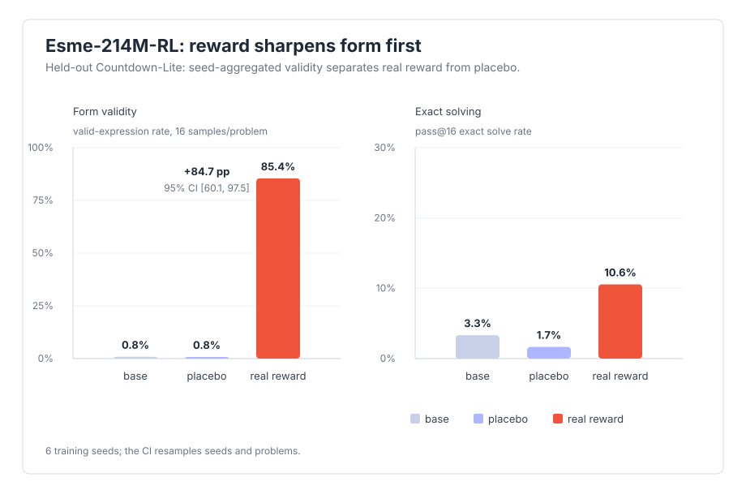

# Esme-214M findings: reward shapes form first

_Esme-214M-RL (GRPO from Esme-214M-Chat) · 6 real-reward seeds vs 6 random-reward placebo
seeds, same recipe and budget · 30 held-out Countdown-Lite problems · 16 samples per problem
at temperature 1.0, 12-token budget_

**Result.** Real reward teaches well-formed answers: valid-expression rates are 85.4% vs 0.8%
for real reward vs placebo, **+84.7 pp, 95% CI [+60.1, +97.5]**. Exact solving moves the
same way but barely clears zero: **+8.9 pp, 95% CI [+0.6, +19.4]**. At 214M parameters, RL
sharpens form first and solving second.

## Metrics

- **Valid-expression rate:** the sample is a legal Countdown-Lite expression that uses each
  given number once with `+ - *`, whether or not it hits the target.
- **Exact-solve pass@k:** the sample hits the target.

The training reward pays `invalid 0.0 < valid expression 0.3 < exact 1.0`, so a real
verifier reward should separate from a random one on validity first. Greedy exact pass@1
is too coarse for a 214M model (its whole range is one or two problems), so both metrics
use 16 samples per problem.

## Per seed

| Seed | correct valid | random valid | Δ valid | correct any-exact | random any-exact |
| --- | ---: | ---: | ---: | ---: | ---: |
| 214 | 27.1% | 0.8% | +26.2 pp | 4/30 | 0/30 |
| 215 | 97.7% | 0.4% | +97.3 pp | 3/30 | 0/30 |
| 216 | 97.1% | 0.8% | +96.2 pp | 3/30 | 1/30 |
| 217 | 97.1% | 0.6% | +96.5 pp | 3/30 | 0/30 |
| 218 | 96.7% | 0.6% | +96.0 pp | 3/30 | 1/30 |
| 219 | 96.9% | 1.2% | +95.6 pp | 3/30 | 1/30 |

| Arm | valid-expr rate | pass@1 | pass@8 | pass@16 | any-exact solved |
| --- | ---: | ---: | ---: | ---: | ---: |
| base (Esme-214M-Chat) | 0.8% | 0.2% | 1.7% | 3.3% | 1/30 |
| correct (real reward) | 85.4% | 9.0% | 10.3% | 10.6% | 3.17/30 |
| random (placebo) | 0.8% | 0.1% | 0.8% | 1.7% | 0.50/30 |

Both intervals pair each seed with its own placebo per problem, and resample seeds and
problems together (6 seeds × 30 problems).

## Reading

- **Validity is robust.** Real reward reaches about 97% valid expressions in five of six
  seeds. Seed 214 reaches 27%. The placebo stays at the base rate in all six.
- **Exact solving rests on three problems.** Every real-reward seed solves the same three
  (`easy_0000`, `easy_0002`, `medium_0004`; seed 214 adds `medium_0003`). The effect is
  consistent across seeds, but resampling problems makes its interval wide.

## Limitations

- **Small sample.** With six seeds the seed resample is coarse, so read the bounds as
  approximate.
- **Form is not solving.** A valid expression can still miss the target, which is why exact
  solving is reported separately.

Reproduce: `make reproduce-esme` recomputes `sampled_multiseed_summary.json` from the raw
completions in `completions/` with `scripts/esme_sampled_decomp.py`.
